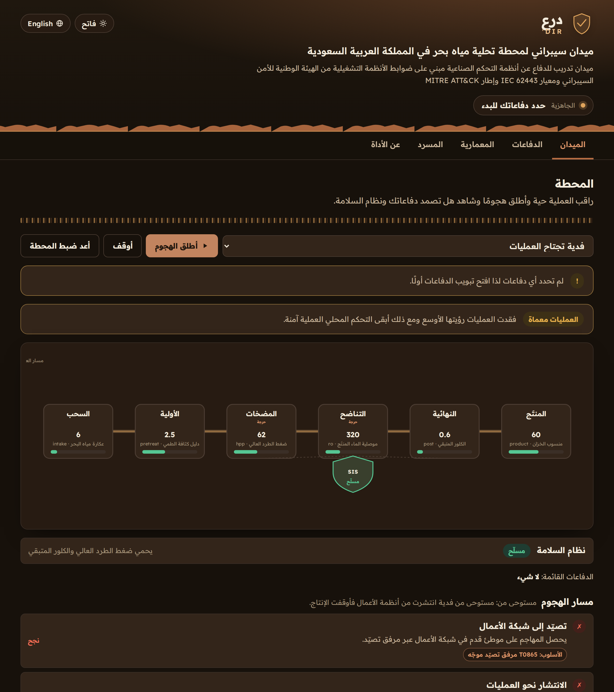
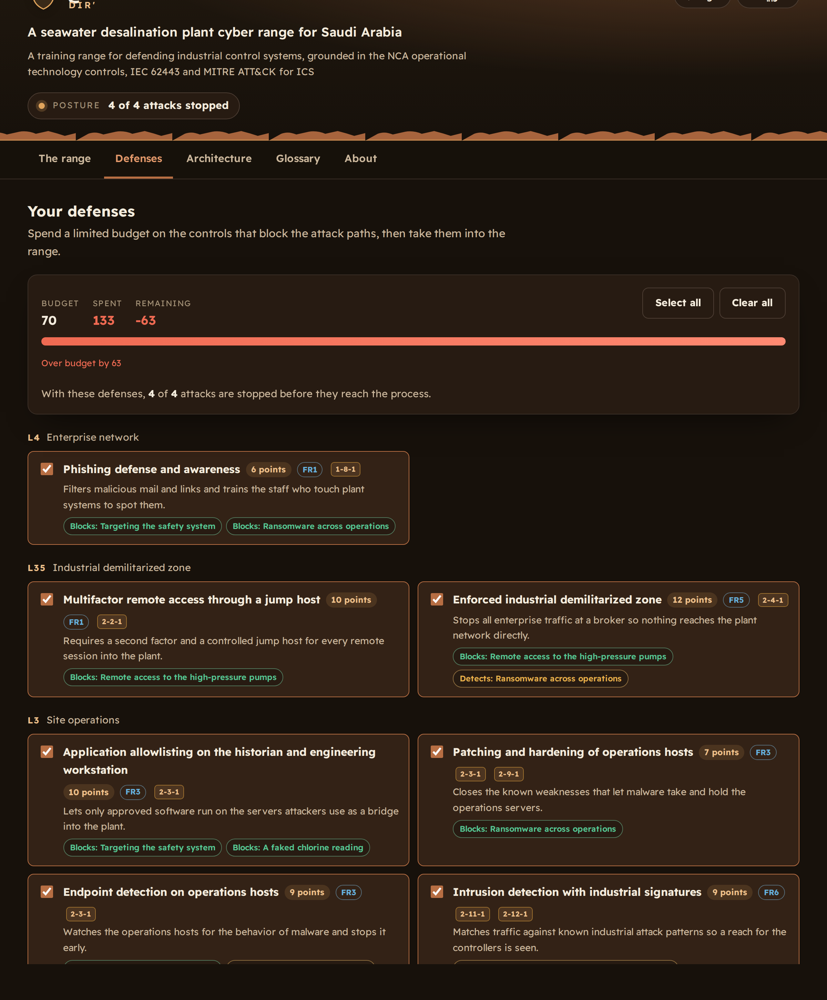

<div align="center">

# درع &middot; Dir'

**An open source seawater desalination plant cyber range for Saudi Arabia**

ميدان سيبراني مفتوح المصدر لمحطة تحلية مياه بحر في السعودية

[**Open the live range &rarr; dir.3li.info**](https://dir.3li.info/)

</div>

---

## What this is

Dir' is a browser based cyber range for defenders of operational technology. It shows a fictional
seawater desalination plant as a live process, lets you spend a limited budget on defensive controls,
then launches realistic attacks and shows you the ending your defenses earned. The safety instrumented
system is a first class character: in most scenarios it trips the plant to a safe state and diverts
off-spec water to waste even when the attacker gets in, and only a specific safety focused attack can
defeat it and let unsafe water reach the network.

Every defensive control is mapped to the National Cybersecurity Authority Operational Technology
Cybersecurity Controls, so the range doubles as a way to see OTCC coverage grow as you build. Everything
is bilingual in Arabic and English, works offline as static files and ships with a Model Context
Protocol server so an AI assistant can teach from the same model.

درع ميدان سيبراني في المتصفح للمدافعين عن أنظمة التشغيل الصناعية يعرض محطة افتراضية لتحلية مياه البحر
كعملية حية ثم يتيح لك إنفاق ميزانية محدودة على ضوابط دفاعية ثم يطلق هجمات واقعية ويظهر لك النهاية التي
حققتها دفاعاتك. نظام الأمان المجهز هو بطل القصة لأنه في معظم السيناريوهات يوقف المحطة إلى حالة آمنة
ويحوّل الماء المخالف للمواصفة إلى الصرف حتى لو دخل المهاجم ولا يكسره إلا هجوم واحد يستهدف الأمان نفسه
فيسمح للماء غير الآمن بالوصول إلى الشبكة.

## The name

A **dir'** is the shield a defender raises in the field to cover themselves and those behind them. The
plant is what you place the shield in front of. From behind the dir' you watch the attacker move along
the kill chain, and you decide what to guard.

الدرع هو ما يرفعه المدافع في الميدان ليقي به نفسه ومن خلفه. المحطة هي ما تضع الدرع أمامه فمن خلف الدرع
ترى المهاجم يتحرك عبر سلسلة الهجوم ثم تقرر ما الذي تحميه.

## Features

- A live plant schematic with six process units from seawater intake to product water, real variable bands and a safety system that arms, trips or is defeated in front of you
- A defense budget that is smaller than the full catalog, so every choice is a tradeoff
- Four scenarios whose steps map to MITRE ATT&CK for ICS techniques, including a TRITON style attack on the safety system and a spoofed chlorine analyzer
- Outcomes that follow engineering logic: contained, a safe trip and diversion, an operational disruption, or unsafe water reaching the network
- Every defense mapped to the NCA OTCC, with a coverage view across the 47 controls and 23 subdomains
- An incident playbook for each scenario aligned to the NCA phases and reporting to the National Cybersecurity Authority
- A Purdue model view with the seven IEC 62443 foundational requirements
- A bilingual OT, ICS and desalination glossary
- A dark desert theme by default and a light theme, full keyboard access and a strict Content Security Policy
- A zero dependency MCP server that exposes the whole model as read only tools

## Screenshots

<div align="center">





</div>

## The MCP server

Dir' ships an MCP server so any assistant that speaks the Model Context Protocol can read the plant, the
controls, the attack paths, the playbooks and the OTCC mapping, and can run the same planner the site
uses. It has no dependencies and it is read only.

Run it directly from the repository:

```
npx -y github:SiteQ8/Dir
```

Point your MCP client at that command:

```json
{
  "mcpServers": {
    "dir": {
      "command": "npx",
      "args": ["-y", "github:SiteQ8/Dir"]
    }
  }
}
```

### Tools

| Tool | What it returns |
| --- | --- |
| `overview` | What the range is, its counts and the training disclaimer |
| `list_units` | The six process units, their variable bands and the safety system |
| `list_zones` | The Purdue levels and the seven IEC 62443 foundational requirements |
| `list_controls` | The defensive controls with level, requirement, the OTCC controls they satisfy, cost and what they block or detect |
| `list_otcc` | The NCA OTCC reference: 4 domains, 23 subdomains and 47 main controls |
| `list_scenarios` | The scenarios with a short summary of each kill chain |
| `get_scenario` | One scenario in full with every step, its MITRE technique, the lesson and the playbook |
| `plan_defense` | Run a scenario against chosen controls and get each step state and the outcome |
| `assess_posture` | Budget spent, coverage by requirement, level and OTCC, and how many attacks a set of controls stops |
| `glossary` | The OT, ICS and desalination glossary, with an optional query in Arabic or English |
| `sources` | The authoritative sources behind the range |

## Run locally

Requirements: Node 18 or newer.

```
git clone https://github.com/SiteQ8/Dir.git
cd Dir
npm run build       # assemble docs/data/bundle.json from data/src
npm test            # run the full test suite
npm run preflight   # build, test and check the site is release ready
```

Serve the site with any static server from the `docs` folder, for example:

```
python3 -m http.server 8000 --directory docs
```

## How it is built

- `data/src` holds the plant, zones, controls, scenarios, incident phases, the OTCC reference, the glossary and every bilingual string
- `scripts/build.mjs` assembles those into `docs/data/bundle.json` and cross checks every reference
- `docs/assets/core.js` is the pure engine, shared by the site and the MCP server
- `docs/assets/app.js` renders the site and drives the live simulation
- `mcp/server.mjs` is the MCP server
- `test` enforces the data model, the engine outcomes, the Arabic writing rules, the Content Security Policy and the MCP contract

## Sources

- National Cybersecurity Authority, Operational Technology Cybersecurity Controls (OTCC-1:2022)
- National Cybersecurity Authority, Essential Cybersecurity Controls (ECC-2:2024)
- NIST SP 800-82 Guide to Operational Technology Security
- NIST SP 800-61 Computer Security Incident Handling Guide
- ISA and IEC 62443 series for industrial automation and control systems security
- MITRE ATT&CK for ICS

## Disclaimer

The plant is fictional and composite. It is not any real facility and it carries no operational detail
from any real plant. Dir' is for learning defensive engineering only. See NOTICE.md.

## License

MIT. Copyright (c) 2026 Ali AlEnezi. See LICENSE.
